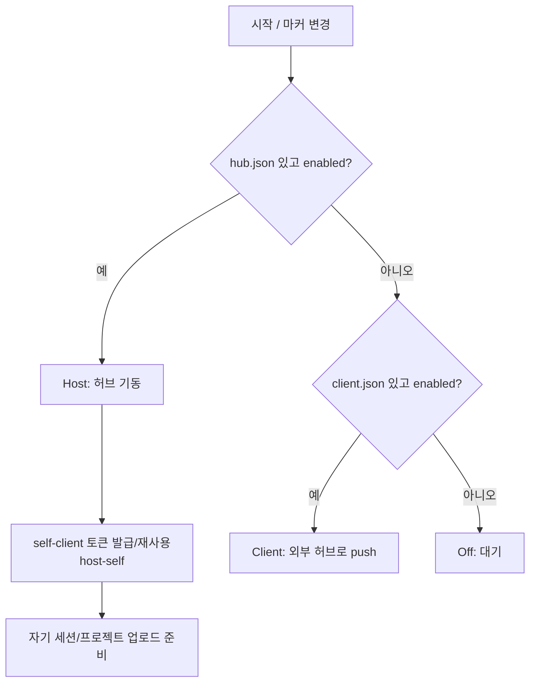
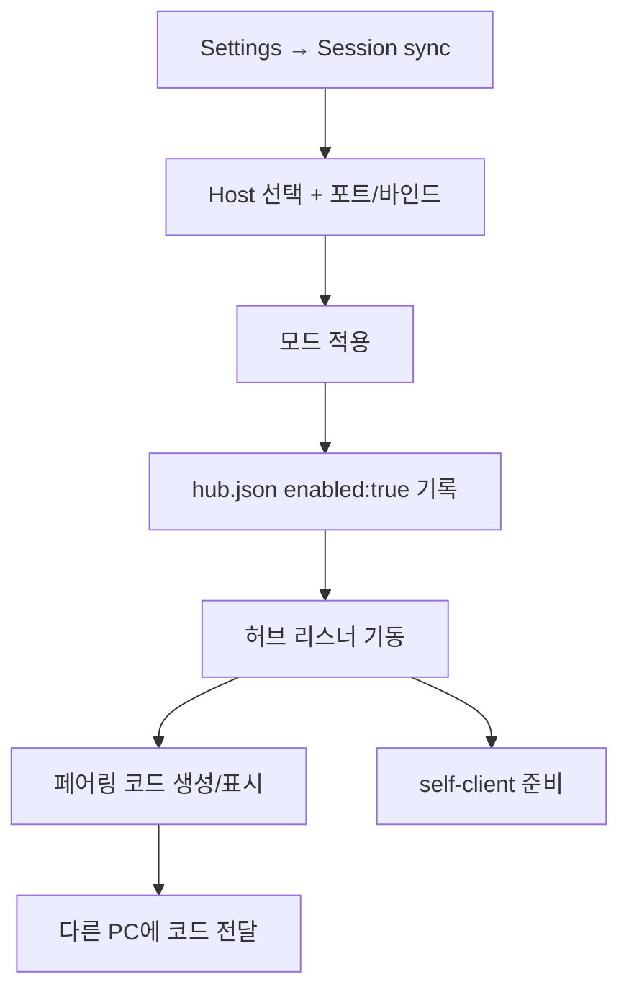
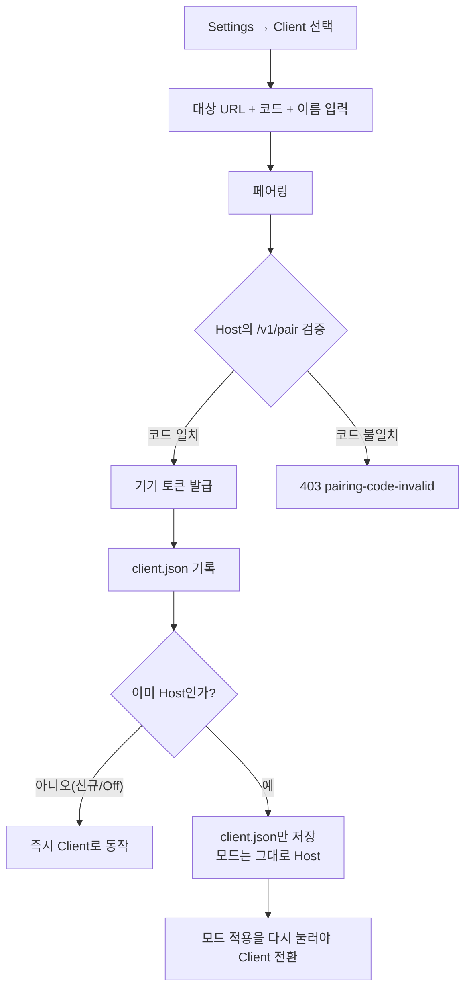
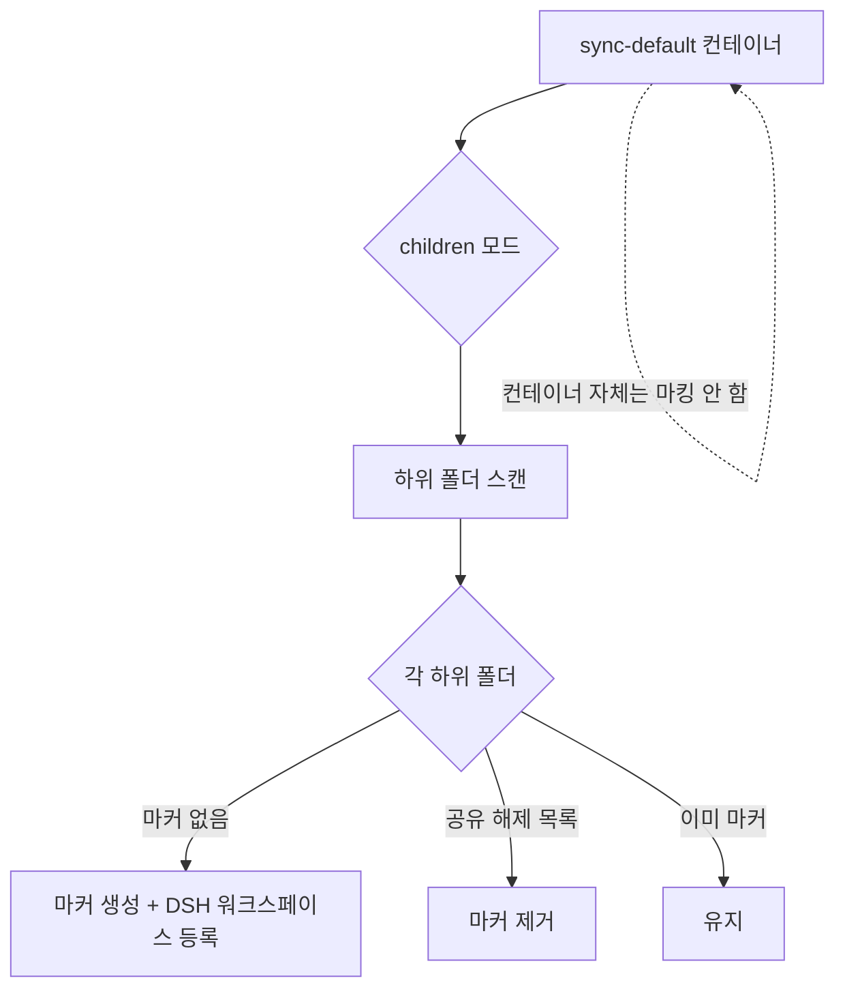
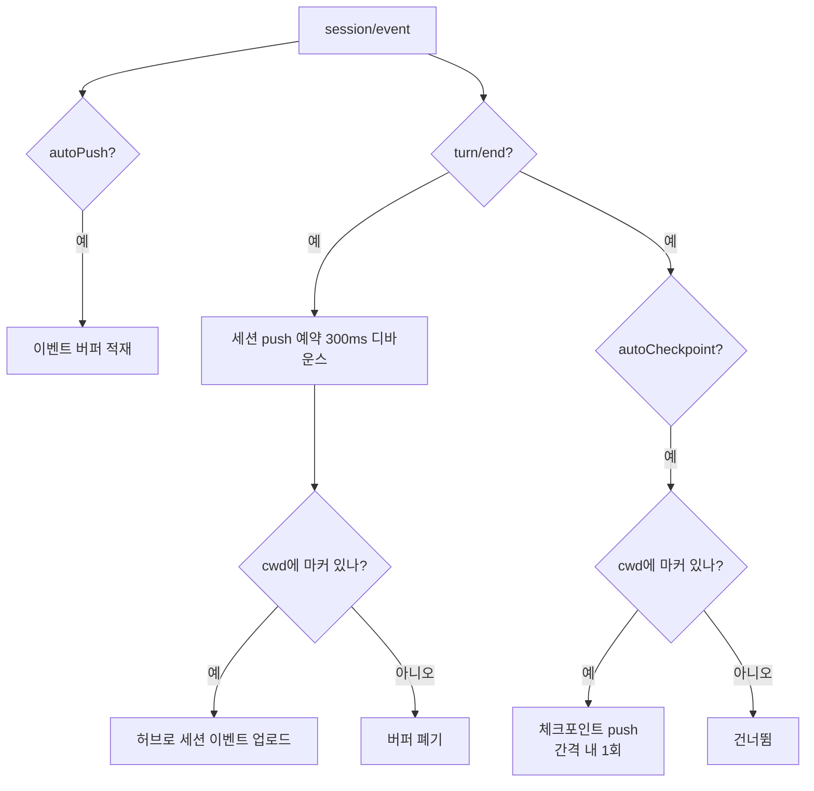
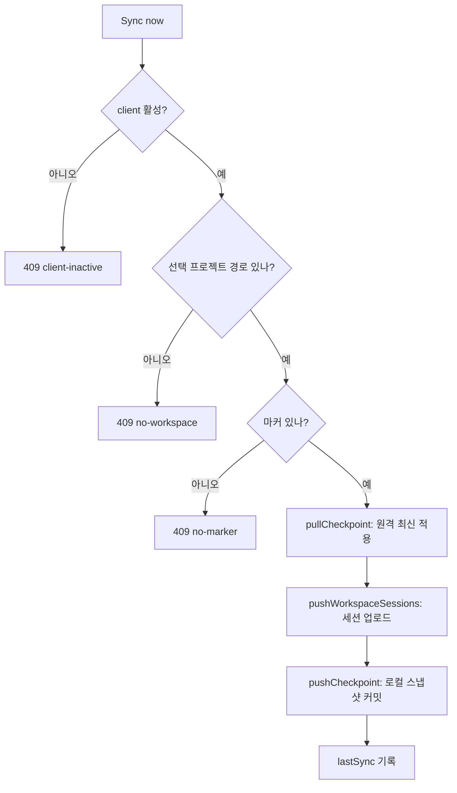
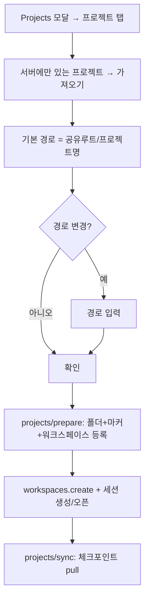

# Session Sync 사용 매뉴얼 & 흐름 검토

대상 버전: **v0.9.7** · 프로토콜 `1` · DSH `0.2.2-rc.3`

이 문서는 현재 코드가 실제로 하는 동작을 그대로 설명하고, 흐름도(flowchart)로 그린 뒤,
검토에서 발견한 **흐름이 끊기는 지점**과 수정 내역을 기록합니다.

---

## 1. 한 줄 요약

개인용 **허브(Hub)** 를 중심으로, 여러 PC의 **DSH 세션 이력**과 **프로젝트(워크스페이스) 파일 스냅샷**을
동기화합니다. 쓰기는 **프로젝트당 한 대의 PC**가 한다는 전제이며, 세션/체크포인트는 **턴 종료 시 자동 업로드**,
파일 내려받기는 **요청할 때(pull on demand)** 입니다.

- **Host** = 허브를 띄우는 PC. 자기 세션/프로젝트도 자체 허브로 올립니다(self-sync).
- **Client** = 다른 Host의 허브에 붙는 PC.
- **Off** = 아무것도 하지 않음.

> Host와 Client는 **배타적 모드**입니다. 한 PC는 동시에 Host이면서 다른 허브의 Client가 되지 않습니다.

---

## 2. 구성 요소와 데이터 위치

| 구성 | 파일 | 역할 |
|---|---|---|
| Host 플러그인 | `index.js` | 모드 해석, 허브 기동, self-client, 세션/체크포인트 업로드, Settings API |
| 허브 서버 | `src/hub-server.js` | `/v1/*` HTTP, 토큰 인증, 페어링, 세션/폴더/블롭 저장 |
| 동기화 클라이언트 | `src/sync-client.js` | push/pull, 3-way 병합, 충돌 보관 |
| 매니페스트 | `src/manifest.js` | 워크스페이스 스캔, base/local/remote 3-way差分 |
| Settings 라우트 | `src/ui-api.js` | `/session-sync/api/*` (브라우저 인증) |
| 클라이언트 UI | `client.js` | Settings 섹션, Projects 모달, 세션 배지 |

데이터 디렉터리(기본 `%USERPROFILE%\.dsh\dsh-sync`):

```
hub.json            허브 활성화/바인드/포트
client.json         외부 허브 페어링 정보 (Client 모드)
self-client.json    Host 자체 업로드용 토큰 (host-self)
ui.json             선택된 프로젝트 경로, 공유 해제 목록, 마지막 동기화
update-check.json   업데이트 확인 캐시
hub/                허브 저장소 (sessions/, folders/, blobs)
```

프로젝트 폴더 안:

```
.dsh-sync.json      folderId 마커 (공유 대상 표시, 체크포인트에 함께 실려 다른 PC로 전파)
.dsh-sync/base.json 이 PC가 마지막으로 적용한 매니페스트
.dsh-sync/conflicts/<stamp>/  충돌 시 원격 사본 보관
```

---

## 3. 모드 해석 (role: auto)

`hub.json`/`client.json` 두 마커 파일로 시작 시 모드를 결정합니다. 파일 변경을 감시(watch)해 자동 재해석합니다.



- `role: hub` / `role: client`로 고정하면 마커와 무관하게 해당 모드.
- **Host가 켜져 있으면 client.json이 있어도 Host가 우선**입니다. 외부 client.json은 Client 모드에서만 사용됩니다.

---

## 4. Host 설정 흐름



- 바인드 `127.0.0.1` = 같은 PC 전용. LAN/원격은 `0.0.0.0`(또는 터널/Caddy 뒤).
- Hub가 켜지면 **이 PC의 세션과 프로젝트도 자체 허브로 업로드**됩니다.
- CLI: `/session-sync init-hub [host] [port]`, `/session-sync code [rotate]`, `/session-sync status`.

---

## 5. Client 페어링 흐름



> **검토 포인트 (흐름 끊김 후보):** 이미 Host인 PC에서 페어링하면 토큰만 저장되고 모드는 Host로 남습니다.
> Client로 전환하려면 **모드 적용을 한 번 더** 눌러야 합니다. 신규/Off PC에서 페어링하면 즉시 Client가 됩니다.
> 이 두 단계 동작은 의도된 설계이며, UI는 `적용 대기(Pending apply)`로 표시합니다. (§11 참조)

---

## 6. 프로젝트 공유(마킹)

프로젝트는 **`.dsh-sync.json` 마커가 있는 폴더**만 동기화됩니다.

- `sync-default`는 **컨테이너**입니다. 기본 `children` 모드에서 그 **바로 아래 하위 폴더**들이 개별 프로젝트로
  자동 등록/공유됩니다. 컨테이너 자체는 공유하지 않습니다.
- `defaultWorkspaceMode`: `children`(기본) / `root`(컨테이너 자체를 프로젝트로) / `off`(자동 등록 끔).
- Settings에서 경로 입력 → **프로젝트 공유**로 임의 폴더를 마킹할 수 있습니다.



> **검토에서 발견한 끊김 (수정됨):** children 모드에서 Settings 경로 입력이 **컨테이너(sync-default)로 기본 설정**되고,
> 그 상태에서 **프로젝트 공유**를 누르면 컨테이너 자체가 마킹되어 설계와 어긋났습니다.
> → **수정:** children 모드에서 컨테이너 마킹을 거부하고, 경로 입력은 실제 공유 프로젝트로 기본 설정합니다. (§11)

---

## 7. 자동 동기화 (업로드)



- **마커가 없는 워크스페이스의 세션/체크포인트는 업로드하지 않습니다.**
- 세션 push는 허브 head에 맞춰 seq를 정렬하고, 빈 구간은 로컬 JSONL에서 backfill합니다.
- 체크포인트는 마지막 적용본(base)과 동일하면 건너뜁니다.

---

## 8. 수동 동기화 (Sync now) & 가져오기(Join)

### Sync now (Settings)

선택된(마지막 마킹된) 프로젝트에 대해 **pull → 세션 업로드 → push** 순서로 수행합니다.



### Join (Projects 모달 → 가져오기)

받는 PC에서 **프로젝트 선택 → 경로 확인 → 세션 생성 → 동기화** 순서입니다.



- 기본 경로는 `defaultWorkspace`(공유 루트) 아래 프로젝트명. **경로 변경**으로 임의 지정 가능.
- 이미 다른 projectId 마커가 있는 폴더면 `409 project-mismatch` → 경로를 바꿔야 합니다.
- **Join은 워크스페이스 파일만** 받습니다. 세션 이력은 가져오지 않습니다.

---

## 9. 통합 Projects 모달 (프로젝트/세션 확인)

New session 옆 **Projects** 버튼이 Host/Client 공용 관리 화면입니다. 별도 Host 전용 패널은 없습니다.

- **프로젝트 탭**: 로컬 워크스페이스 + 허브 프로젝트를 `folderId` 기준으로 합쳐 한 목록으로 표시.
  - `동기화됨`(양쪽) / `서버에만 있음`(가져오기 제공) / `로컬에만 있음`.
- **세션 탭**: 허브에 저장된 **모든 세션**(제목·경로·생성시각·head 버전)을 표시.

> **검토에서 발견한 끊김 (수정됨):** 모달에서 **가져오기(신규)만** 가능하고, 이미 로컬에 있는 프로젝트의
> **최신을 다시 받는 동작**이 모달 안에 없었습니다. 사용자는 Settings의 Sync now로 돌아가야 했고,
> 그마저도 "마지막 마킹된 프로젝트 하나"만 동기화했습니다.
> → **수정:** 이미 로컬+서버에 있는 프로젝트 행에 **동기화(pull)** 버튼을 추가해, 모달 안에서 바로 최신을 받게 했습니다. (§11)

---

## 10. 업데이트

- Settings 하단/일반 행에서 **설치 버전 vs 최신 GitHub 태그**를 비교합니다. (1시간 캐시, 수동 확인은 60초 하한)
- **설치는 하지 않습니다.** 실제 업데이트는 DSH **Plugin Manager**가 담당합니다
  (Plugins → 해당 번들 → Update 또는 최신 GitHub URL 재설치).
- 실행 중인 플러그인이 자기 번들을 교체하면 허브 중단·응답 유실·HMR 실패가 생기므로, 이 플러그인은
  `installBundle`을 직접 호출하지 않습니다.

---

## 11. 흐름 검토: 발견한 끊김과 수정

| # | 끊김 | 영향 | 수정 |
|---|---|---|---|
| B | children 모드에서 Settings 경로가 **컨테이너로 기본 설정**되고 컨테이너를 **마킹/공유**할 수 있었음 | 컨테이너 전체가 한 프로젝트로 커밋되는 설계 위반 | children 모드에서 컨테이너 마킹 **거부**(명확한 오류), 경로 입력은 **실제 공유 프로젝트**로 기본 설정 |
| C | Projects 모달에서 **가져오기만** 가능, 기존 프로젝트 **재동기화** 불가 | 통합 관리 화면에서 최신을 받을 수 없어 Settings로 우회 | 로컬+서버 프로젝트 행에 **동기화(pull)** 버튼 추가(기존 `projects/sync` 라우트 사용) |

### 의도된 동작(수정하지 않음) — 오해하기 쉬운 지점

- **Host에서 페어링해도 모드는 Host 유지.** Client 전환은 `모드 적용`을 한 번 더 눌러야 합니다. (신규/Off에서는 페어링 즉시 Client)
- **자동 pull은 없습니다.** 받는 쪽은 Sync now / 가져오기 / 동기화 버튼으로 명시적으로 받습니다.
- **세션 이력은 허브에 저장·조회만** 되며 로컬 DSH 세션으로 가져오지 않습니다.
- **프로젝트당 1개의 로컬 루트.** 서로 다른 여러 루트를 한 프로젝트로 묶을 수 없습니다.
- **동시 쓰기 비보장.** 두 PC가 같은 프로젝트를 동시에 편집하면 마지막 push가 이깁니다(3-way 병합은 pull 시에만).
  프로젝트당 한 대만 쓰다는 전제입니다.

---

## 12. 빠른 참조 (문제 해결)

| 증상 | 확인 |
|---|---|
| Projects/세션 목록이 비어 있음 | Host 실행 중 또는 Client 페어링 여부. Off면 허브를 읽을 수 없음 |
| `409 client-inactive` | 모드가 Off이거나 허브/클라이언트 미기동 |
| `409 no-marker` / `no-workspace` | 프로젝트 공유(마킹) 먼저 |
| `409 project-mismatch` | 해당 폴더가 다른 projectId → 경로 변경 |
| `403 pairing-code-invalid` | 코드 불일치/만료 → Host에서 코드 회전 후 재시도 |
| 세션 배지가 Local | 해당 세션 cwd에 마커 없음(공유 프로젝트가 아님) |